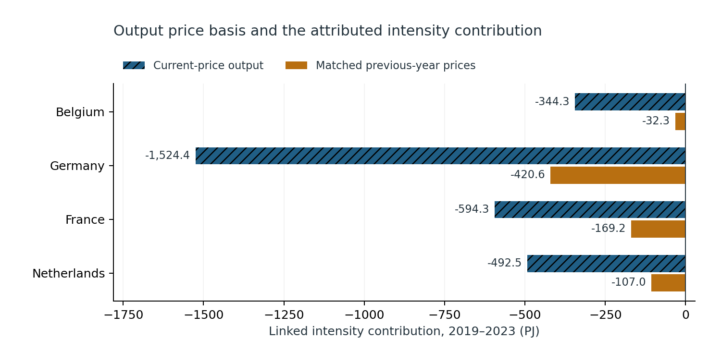
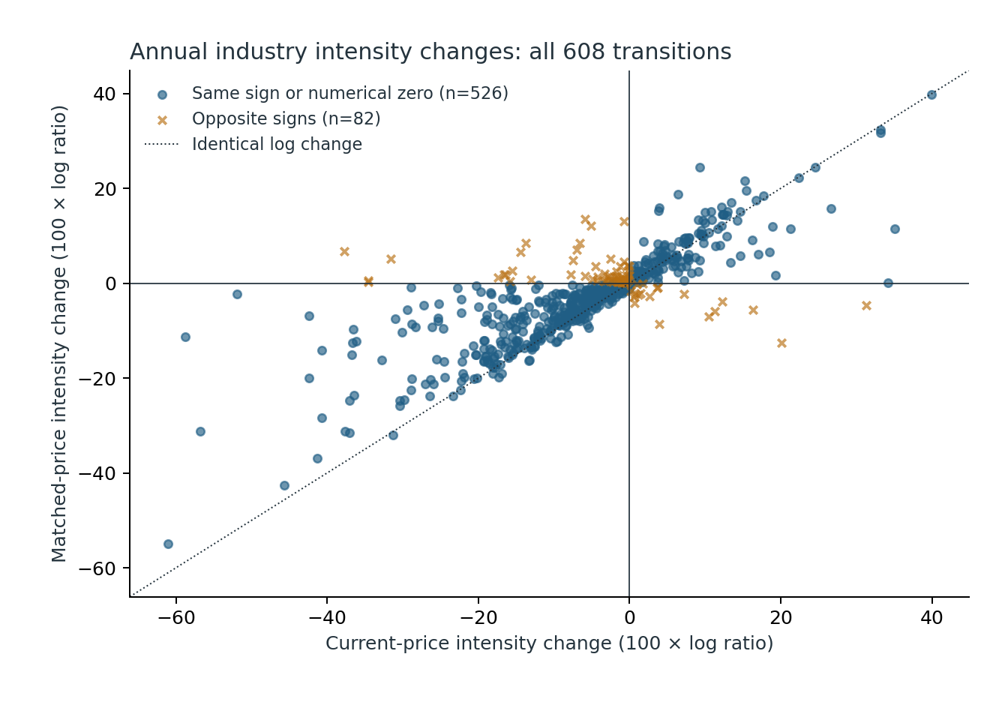
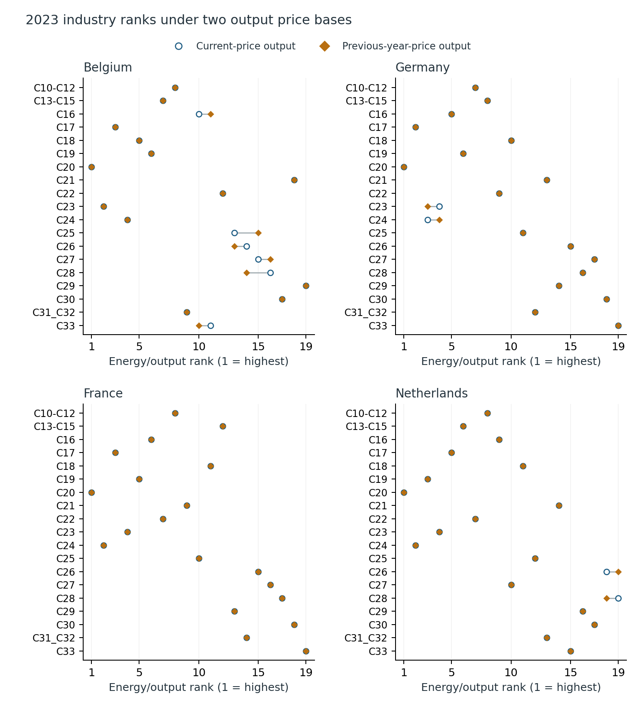

# Output prices change the explanation of manufacturing energy use

An industrial analyst needs to distinguish production scale, industry mix and energy use per unit of output. This Eurostat accounting study compares nominal and matched previous-year-price output across nineteen manufacturing groups, 2015–2023. Belgium, Germany, France and the Netherlands pass the fixed source gate; Spain and Italy remain excluded with missing cells and break flags preserved.

**Finding:** 82 of 608 annual industry intensity changes (13.5%) have opposite signs under the two output price bases. Germany's linked 2019–2023 intensity contribution is −1,524.4 PJ using nominal output and −420.6 PJ using matched prices; observed energy falls by 622.5 PJ under both calculations. Yet every country's 2023 top-five industry set remains the same. Use matched-price annual output to discuss intensity progress, retain the nominal comparison, and examine the physical total separately.

These are descriptive accounting results. Net domestic energy use includes non-energy uses. Gross output is not GDP, energy bills or plant efficiency. The study makes no causal, energy-cost, carbon, financial-return or new-method claim. Excluded countries account for 28.9% of 2023 energy within the original six-country set; the panel is not all Europe. Germany retains provisional flags. Historical snapshots do not reconstruct real-time information vintages.

Read the [seven-page independent manuscript](paper/manuscript.pdf), [fixed protocol](PROTOCOL.md), [source context](SOURCES.md), [data rights](DATA_RIGHTS.md) and [review receipt](paper/REVIEW.json). This is independent, AI-assisted research, not peer reviewed or a journal submission. Exact-head Linux CI, merge and tag verification remain required before the program counts a release.







The [retained API manifest](data/source/manifest.json) identifies twelve exact source responses. The [full panel](data/panel.csv) preserves missing values and flags. [Source accounting](results/source_accounting.json) retains every exclusion. [Results](results/analysis) include all annual and linked effects, every sector contrast, volume-index cross-check, full 2023 ranks and every omit-one-industry sensitivity. No chain-linked industry levels are summed. No sampling interval is invented for revised aggregate accounts.

## Reproduce the retained snapshot

Use Python 3.10 and the pinned requirements. The source is already retained; a replay does not retrieve or silently replace it with a new vintage.

```sh
python -m pip install -r requirements.txt
python -m unittest discover -s tests -v
python src/check_reproduction.py
python src/verify_figures.py
python src/verify_paper.py
```

Seven boundary tests cover accounting identities, scaling, ordering and invalid inputs. An independent mixed-radix/SQL path checks all 4,320 selected source cells. A separate 50-digit Decimal implementation checks all 16,724 four-country numerical values without importing the main accounting code. Fresh replay rebuilds 42,515 CSV numerical values. Strict scientific comparison tolerances are absolute 1e-7 / relative 1e-9; source-rounding and official-index consistency bounds are separate. [Code freeze](results/CODE_FREEZE.json) precedes Belgium's analytic outputs; six-country source-coverage totals were permitted earlier. Belgium is an implementation-transfer check, not population generalization.

To export the original figures again, run `python src/figures.py`, then `python src/verify_figures.py`. Rebuilding the manuscript separately requires LaTeX/Tectonic: compile `paper/main.tex` with `paper/` as the output folder, then rename `main.pdf` to `manuscript.pdf`. PDF hashes bind the reviewed edition; a rebuilt PDF needs fresh rendered review and an updated publication manifest. CI verifies the retained reviewed PDF and reproduces the numerical analysis; it does not recompile the manuscript.

Only this reviewed independent program study is authorized for public release here. Separate formal-publication projects, including Azure optimization, remain private.
